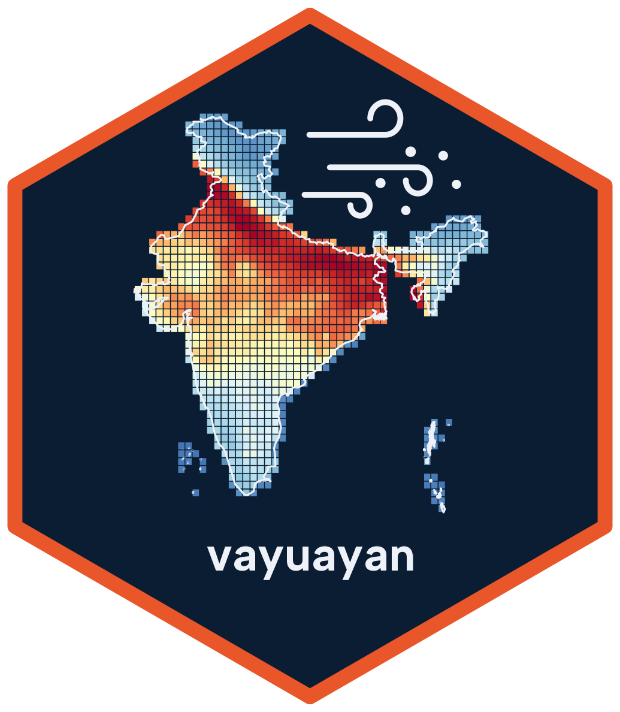

# vayuayan 

[](https://github.com/saketlab/vayuayan/actions)
[](https://opensource.org/licenses/MIT)

`vayuayan` is an R package. It downloads and processes air quality data from three sources:
CPCB CAAQMS monitoring stations in India, OAQ low-cost sensor networks in India, and WUSTL ACAG satellite PM2.5 estimates for the whole globe.
The package gives an easy R interface to get daily AQI, PM2.5 and other pollutants for a city, a station, a point or a region.
The name means "the path of wind" (वायु, wind + अयन, path).

## Installation

```r
# Install from GitHub
# install.packages("devtools")
devtools::install_github("saketlab/vayuayan", subdir = "R")
```

## Quick Start

### CPCB monitoring stations

```r
library(vayuayan)

# Find the stations in a city
stations <- cpcb_get_station_list("Mumbai")

# Daily AQI for two cities in 2022, one row per city and day
daily <- cpcb_city_daily(c("Delhi", "Mumbai"), 2022)
aggregate(value ~ city + month, daily, mean)

# Daily data for single stations
station_daily <- cpcb_station_daily(c("Anand Vihar, Delhi", "ITO, Delhi"), 2024)
```

### Live AQI

```r
# The 5 live stations nearest to central Delhi
cpcb_get_nearest_stations(c(28.6139, 77.2090), k = 5)
```

### Satellite PM2.5

```r
# Monthly PM2.5 at a point. region = "AS" downloads the smaller Asia file.
pm25_get_point(latitude = 28.61, longitude = 77.21, year = 2023, month = 11, region = "AS")

# Monthly mean PM2.5 over Delhi
delhi <- india_boundary(state = "Delhi")
pm25_monthly(delhi, 2022, region = "AS")
```

### OAQ low-cost sensors

```r
# Get your API key from OAQ and set it in ~/.Renviron as OAQ_API_KEY
session <- oaq_session()
oaq_list_providers(session)
sensors <- oaq_stations_table(session, "airnet")
```

## Use cases

### Seasonal pattern of a city

```r
library(dplyr)
library(ggplot2)

cpcb_city_daily("Delhi", 2022) %>%
  group_by(month) %>%
  summarise(mean_aqi = mean(value, na.rm = TRUE)) %>%
  ggplot(aes(month, mean_aqi)) +
  geom_line(colour = "#d77027") +
  scale_x_continuous(breaks = 1:12, labels = month.abb) +
  labs(title = "Delhi 2022: monthly mean AQI", x = NULL, y = "AQI")
```

### Satellite PM2.5 by state

```r
# Mean PM2.5 for each state in a district GeoJSON
pm25_get_stats(
  geojson_file = "india_districts.geojson",
  year = 2023,
  month = 11,
  region = "AS",
  group_by = "state_name"
)
```

## Documentation

- Introduction: `vignette("introduction", package = "vayuayan")`
- [Articles](https://vayuayan.saketlab.org/R/articles/index.html): analyses of
  Delhi, five metros, and CPCB against Airnet sensors in Bengaluru
- [Function Reference](https://vayuayan.saketlab.org/R/reference/index.html)

## Contributing

We accept contributions. To send a change, open a Pull Request.

## Disclaimer

This package is not affiliated with CPCB, OAQ or WUSTL. It is a third-party tool for publicly available data.
