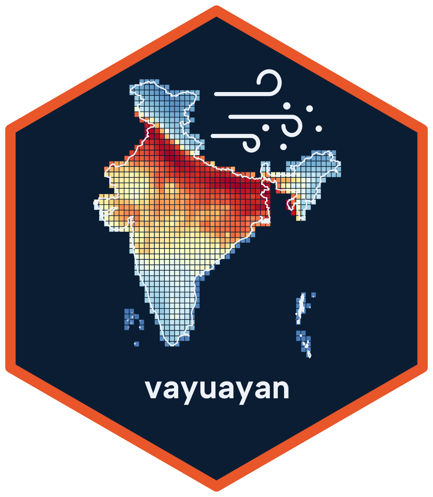
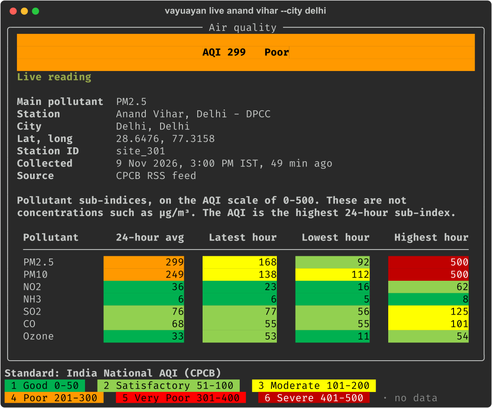

# vayuayan 

Download and analyze air quality data: CPCB CAAQMS stations and OAQ low-cost sensors in India, and WUSTL ACAG satellite PM2.5 for the globe.

| Package | Folder | Install | Docs |
|---|---|---|---|
| Python | [`python/`](python) | `pip install vayuayan` | https://vayuayan.saketlab.org/python/ |
| R | [`R/`](R) | `devtools::install_github("saketlab/vayuayan", subdir = "R")` | https://vayuayan.saketlab.org/R/ |

## Air quality in your terminal

The Python package shows live and historical AQI on the command line:

```bash
pip install vayuayan
vayuayan live                  # the station nearest to you
vayuayan live anand vihar      # a station by name
vayuayan live mumbai           # every station of a city, worst first
vayuayan history powai 2025    # a year as a calendar
```



