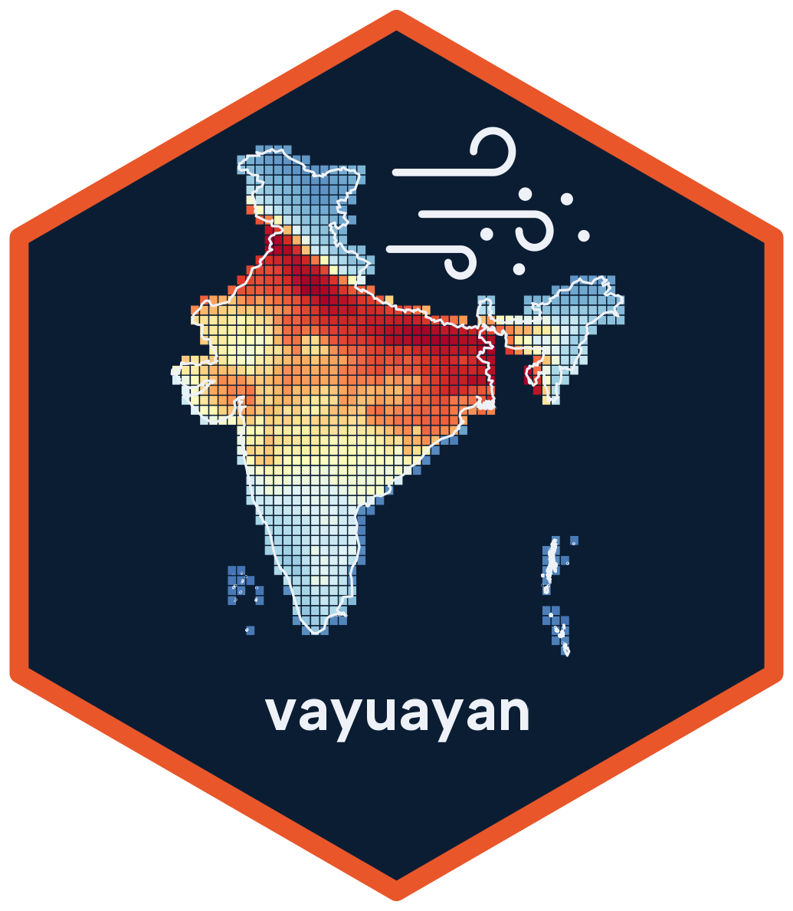
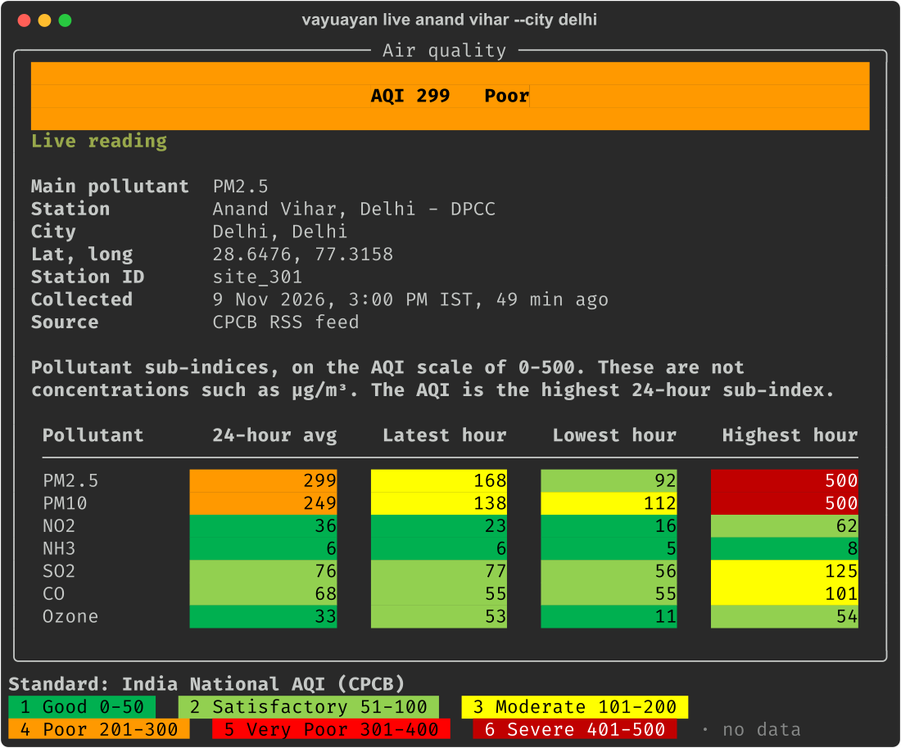

<p align="center">
  
</p>

# Vayuayan

Vayuayan downloads and examines air quality data from three sources:

- The monitoring stations of the [Central Pollution Control Board (CPCB)](https://cpcb.nic.in/) in India.
- Low-cost sensor networks in India, from [Open Air Quality (OAQ)](https://oaq.notf.in).
- [Satellite PM2.5 data](https://sites.wustl.edu/acag/datasets/surface-pm2-5/) for all areas of the Earth, from the Atmospheric Composition Analysis Group (ACAG) at Washington University in St. Louis (WUSTL).

Vayuayan calculates the CPCB National Air Quality Index. It changes CPCB files into tidy (long) tables. It compares sensor data with the US EPA targets for PM2.5 sensors.

## Installation

Install from PyPI (recommended):

```bash
pip install vayuayan
```

The plotting functions (`plot_daily_record_*`) need matplotlib: `pip install "vayuayan[plot]"`.

Install the development version from GitHub:

```bash
pip install "git+https://github.com/saketlab/vayuayan.git#subdirectory=python"
```

Or install from the source code:

```bash
git clone https://github.com/saketlab/vayuayan.git
cd vayuayan/python
pip install -e .
```

## Cache

Vayuayan keeps CPCB files of past years in `~/.cache/vayuayan`. To use a different directory, set `VAYUAYAN_CACHE_DIR`.

## Quick Start

### Command Line Interface

`vayuayan` shows live and historical AQI in your terminal, in the official category colours.



```bash
vayuayan                          # open the menu
vayuayan live                     # air quality near you
vayuayan live anand vihar         # one station, no quotes needed
vayuayan live mumbai              # every station of a city, worst first
vayuayan history powai 2025       # a year as a calendar heatmap
vayuayan history powai 2025 --standard us
vayuayan history delhi 2024 --save delhi.csv
vayuayan history delhi --from 2026-11-08 --to 2026-11-09 --hourly --save x.csv
vayuayan find anand vihar
vayuayan stations --state Kerala
vayuayan pm25 districts.geojson 2023 --month 11 --group-by state_name
```

`vayuayan live` with no place sends your IP address to ip-api.com to find your approximate location.

For scripts and agents, `--json` prints one JSON document on stdout and `--no-input` forbids prompts. Exit codes: 0 success, 1 other error, 2 usage, 3 not found, 4 ambiguous, 5 no data, 6 network or CPCB down, 130 Ctrl-C. See the [CLI reference](https://vayuayan.saketlab.org/python/cli_reference.html).

### Python API

```python
from vayuayan import CPCBHistorical, CPCBLive, PM25Client

# Historical data client
historical = CPCBHistorical()
states = historical.get_state_list()
mumbai_stations = historical.get_station_list("Mumbai")

# Live monitoring client
live = CPCBLive()
location = live.get_system_location()
nearest_station = live.get_nearest_station(location)
current_aqi = live.get_live_aqi_data()

# National AQI from concentrations (24-hour averages; 8-hour for CO and O3)
from vayuayan import compute_aqi

compute_aqi({"PM2.5": 45, "PM10": 80, "NO2": 30})  # AQI 80, Satisfactory, PM10

# Daily AQI and tidy rows from raw CPCB data
daily = historical.daily_aqi("site_301", "2024")
rows = historical.download_raw_aqi_data_station_level("site_301", "2024", "", tidy=True)

# Satellite PM2.5 analysis (V6.GL.03 by default)
pm25 = PM25Client()
# Monthly statistics, and state statistics as a GeoDataFrame for a map
monthly = pm25.get_pm25_monthly_stats("delhi_ncr.geojson", 2023)
state_map = pm25.get_pm25_stats(
    "india_districts.geojson", 2023, 11, group_by="state_name", geometry=True
)
# Combined stats for entire region
delhi_stats = pm25.get_pm25_stats("delhi_ncr.geojson", 2023, 11)
# Stats grouped by state
state_stats = pm25.get_pm25_stats(
    "india_districts.geojson", 2023, 11, group_by="state_name"
)
# Stats grouped by multiple columns (state and district)
district_stats = pm25.get_pm25_stats(
    "india_districts.geojson", 2023, 11, group_by="state_name,district_name"
)
```


## Contributing

We accept contributions. To contribute, open a pull request.

## Disclaimer

This package has no official relation to a government agency or to an air quality monitoring network. It is a third-party tool for public environmental data. Users must make sure that the data is accurate. Users must also give the correct attribution.

## Etymology

**Vayuayan** (वायुअयन) combines two Sanskrit words:
- **Vayu** (वायु): Wind, air 
- **Ayan** (अयन): Path, journey, movement

Thus, "Vayuayan" means "the path of wind". The name refers to the movement of air quality data across space and time.
